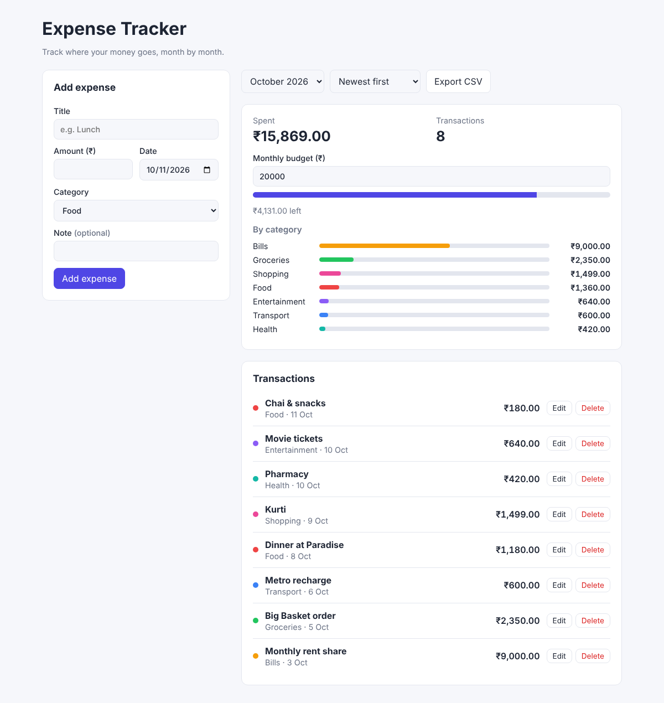

# Expense Tracker

A clean, responsive personal expense tracker built with **React** and **TypeScript**. Add, edit and delete expenses, see where the money goes by category, set a monthly budget and export to CSV. Everything is saved in your browser, so no account is needed.



## Features

- Add, edit and delete expenses with form validation
- Monthly view with a month picker, plus an all-time view
- Category breakdown with proportional bars
- Monthly budget with a progress bar that warns at 80% and turns red when over
- Sort by newest or highest amount
- Export the current view to CSV
- Data saved in `localStorage` through a reusable `useLocalStorage` hook
- Light and dark themes (follows the system setting) and a mobile-friendly layout
- Unit and component tests with Vitest and React Testing Library

## Tech

React 19 · TypeScript · Vite · Vitest · React Testing Library · CSS (no UI framework)

## Getting started

```bash
npm install
npm run dev        # http://localhost:5173
npm test           # run tests
npm run build      # production build in dist/
```

## Project structure

```
src/
  components/      # ExpenseForm, ExpenseList, Summary
  hooks/           # useLocalStorage, useExpenses
  lib/expenses.ts  # pure helpers: totals, grouping, sorting, CSV, formatting
  types.ts         # Expense and Category types
  App.tsx          # page layout and state wiring
```

Business logic lives in pure functions in `lib/`, which keeps components thin and makes the logic easy to test.

## Ideas for next steps

- Recurring expenses
- Charts over time (e.g. Recharts)
- Sync with a backend API
